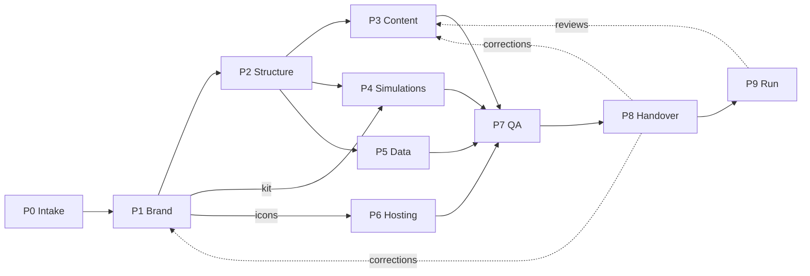

# Client portal roadmap

How a client goes from a website to a branded, hosted, installable learning portal, in
ten phases with a gate at the end of each. It is ONYX reverse-engineered: everything we
did across five working days and twenty-five pull requests, put back into the order it
should have happened in, with the detours taken out and the lessons written in.

This is the structure every client follows. The documents inside it are specific to each
client — their brand file, their portal config, their intake — but the phases, the file
names, the gates and the outputs are the same every time.

| Read this | For |
| --- | --- |
| **This page** | The whole route: phases, gates, outputs, decisions, timings |
| [`docs/playbook/`](playbook/) | How to do each phase, step by step, one numbered file per stage |
| [`workflow/client-portal.workflow.json`](../workflow/client-portal.workflow.json) | The same route as data: what `tools/check-client.js` evaluates and an automation reads |
| [`clients/onyx/`](../clients/onyx/) | The worked example of every output |

---

## The standard outputs

Every client ends with the same set of files. Every file carries the client slug, so
files from different clients never collide in a download folder, an email or a build.

| Deliverable | Files | Made by | Phase |
| --- | --- | --- | --- |
| Intake | `clients/<slug>/<slug>-intake.md` | `tools/new-client.js`, then us | P0 |
| Brand truth | `clients/<slug>/brand/<slug>-brand.json` | us; the only brand file edited by hand | P1 |
| Design tokens | `clients/<slug>/brand/<slug>-tokens.css` | `tools/build-tokens.js` | P1 |
| Brand sheet, for sign-off | `clients/<slug>/brand/<slug>-brand-sheet.html` | us, tokens injected by the build | P1 |
| Written portfolio | `clients/<slug>/brand/<slug>-brand.md` | us | P1 |
| Logo, mark, captures | `clients/<slug>/brand/assets/<slug>-logo.svg`, `<slug>-mark.svg`, `reference/` | us | P1 |
| App icons | `clients/<slug>/brand/assets/icons/*.png` (192, 512, 512 maskable, 180) | `tools/make-icons.js` | P1 |
| SimStudio brand kit | `clients/<slug>/brand/<slug>.simbrand.json` | SimStudio *Settings → Brand kits → Export* | P1 |
| Portal content | `clients/<slug>/portal/<slug>-portal.json` | us | P2–P5 |
| The portal, one file | `clients/<slug>/portal/<slug>-portal.html` | `tools/build-portal.js` | P2 onward |
| Simulations and media | `clients/<slug>/portal/content/sims/`, `sims/src/`, `video/` | SimStudio | P4 |
| Data sample | `clients/<slug>/workbench/demo-data.json` | us, from one real export | P5 |
| The portal, hosted | `clients/<slug>/site/` | `tools/build-portal.js --site` | P6 |

## The phases



| | Phase | Goal | The gate, in one line | Playbook | ONYX took |
| --- | --- | --- | --- | --- | --- |
| P0 | Intake and kickoff | Agree what is built, for whom, by when; send every ask on day one | Scaffold exists, intake answered, asks sent | [00](playbook/00-intake.md) | not a separate step |
| P1 | Brand portfolio | One signed-off source of truth for look, voice and the SimStudio kit | No `_help` or PLACEHOLDER left, sheet sent, kit exported | [01](playbook/01-brand-portfolio.md) | 1 day |
| P2 | Portal structure | Doors, keys, tabs, Home per audience, areas, modules | Client block filled, build current | [02](playbook/02-portal-build.md) | day 1, refined to day 5 |
| P3 | Content authoring | Every item, answer, process and post written in the client's voice | No TODO left anywhere in the config | [05](playbook/05-content-standards.md) | days 1–4 |
| P4 | Simulations and media | Every simulation and video in place of its placeholder, checked in the frame | Nothing on the placeholder, every src resolves | [06](playbook/06-simulations-and-media.md) | first export on day 3 |
| P5 | Reports and data | The owner's Reports reading their own exports | A converter ready, a sample, an Insights example generated | [04](playbook/04-reports-and-data.md) | days 3–5 |
| P6 | Hosting and install | Live on a subdomain over HTTPS, installable, updating on push | Icons present, hosted build current, six live checks passed | [03](playbook/03-hosting-and-install.md) | half a day; 20 minutes next time |
| P7 | QA and walkthrough | Proof every audience works on a phone and a desktop | Smoke test passes, walkthrough done | [07](playbook/07-qa-release-handover.md) | every PR |
| P8 | Handover and sign-off | The client has the portal, the keys, the open items and the caveat | No demo left, brand confirmed, no open asks | [07](playbook/07-qa-release-handover.md) | open: ONYX is a showcase |
| P9 | Run and iterate | The portal stays true | No process past its review, builds current | [07](playbook/07-qa-release-handover.md) | ongoing |

P3, P4 and P5 run side by side once P2 is in place. The critical path is
**P0 → P1 → P2 → P3 → P7 → P8**: simulations and data make the portal better, content
makes it exist. P4 waits on the client's system access and P5 on a real export, which is
why both are asked for in P0.

## Running a client

```bash
node tools/new-client.js acme --name "ACME" --trading "ACME Health & Fitness" --website https://acme.com.au
node tools/check-client.js acme        # where it stands, phase by phase, and what is next
```

The scaffold writes the intake, the brand file, stand-in logo and mark, the portal config
and the content README, then builds — so a grey-box portal opens on day one and every
gate has something to measure. From there the loop is the same in every phase:

```bash
# edit clients/acme/brand/acme-brand.json or clients/acme/portal/acme-portal.json, then
node tools/build-tokens.js acme        # brand changed
node tools/build-portal.js acme        # the single file
node tools/smoke-portal.js acme        # every audience, every page
node tools/check-client.js acme        # what is left
```

## Phase by phase

### P0 · Intake and kickoff

**In:** the go-ahead, the client's site, a main contact. **Out:** the scaffold and
`<slug>-intake.md`, answered.

1. Choose the slug. It is permanent: every file name and the subdomain carry it.
2. Scaffold with `tools/new-client.js`.
3. Send the asks list the same day: master logos, guideline, photos and rights, SOPs and
   checklists, the names of their systems and access to them, one month of each export,
   the legal entity, who owns DNS. Everything the client supplies is on the critical path
   of a later phase, so it is asked for before it is needed.
4. Run the kickoff against the intake: which audiences, what they call their customers,
   which modules are on, the dates.
5. Copy the open asks into `meta.confirmWithClient`; the brand sheet and the handover pack
   both print that list.

**ONYX:** there was no intake. The capture started from the public site and the questions
were answered as the build reached them — which is how five asks are still open a month
later. `clients/onyx/onyx-intake.md` is reconstructed from the repository as the example.

### P1 · Brand portfolio

**In:** sixteen or more phone captures; master files when they arrive. **Out:** the brand
JSON, tokens, sheet, written portfolio, logo and mark, captures, icons, SimStudio kit.

Sample colours with a histogram rather than an eyedropper; identify the typeface; fill
the JSON and delete each `_help` as its section is done; derive the portal tones,
including a translucent `primaryTint`; build the tokens and read the contrast report;
redraw the stand-ins; build and render the sheet at 390px and 1280px; write the `.md`;
set up and export the SimStudio kit; render the icons; send the sheet.

**The rule that carries to every client:** where the site's own pattern fails contrast,
the portal keeps the shape and the colour and changes only the ink. ONYX's white on green
(1.94:1) and white on amber (1.71:1) became ink on both, at 10.22:1 and 11.57:1.

**ONYX:** one working day, 17 September, [#1](https://github.com/Kintukka2/mobile-SS-ClientPortals/pull/1)
and [#2](https://github.com/Kintukka2/mobile-SS-ClientPortals/pull/2). The slug prefix on
every file came in the second pull request, after the first had already named files
`brand.json` and `BRAND.md` — now the scaffold does it from the start.

### P2 · Portal structure

**In:** the intake. **Out:** the config's skeleton, built.

Fill the client block. Set the four audiences — member first with no key, then employee,
manager and owner behind keys, grouped under one door label — and say who `sees` whose
content. Set each audience's tab bar (five at most), and choose its Home: tiles for an
audience that navigates (owner, member), cards for one with a long path (employee), the
path itself for one that works through it (manager). Set the Learn areas and groups.
Switch the optional modules on or off.

**ONYX:** the structure was found by building it. Three audiences on day one; Learn
filtered by type until day two, when it became areas; members arrived on day three and
broke the implicit "everyone sees employee content" rule, which became `sees`; Home tiles,
Home cards, Learn modules and the door label came on days three to five. The template
starts from where ONYX ended.

### P3 · Content authoring

**In:** the client's own SOPs, FAQs and checklists when they have them; the brand voice.
**Out:** a config with no TODO left.

The first path is ten to eighteen items in the order a new starter meets them. Guides
carry steps, checklists carry checks, articles carry paragraphs; a simulation sits in the
group of the guide it teaches. Support opens with the questions and then the problem-led
cards. The process library names, for every process, the training it drives. Anything the
client has not confirmed is `demo: true`. The standards are in
[playbook 05](playbook/05-content-standards.md).

**ONYX:** 57 items, 29 processes and five posts, all written as demo from the public site.
One wrong fact — that RECOVER is walk-in, when it is booked — had spread to five places
before it was caught. Write a fact once, in the item that owns it, and search the config
for it when it changes.

### P4 · Simulations and media

**In:** the kit from P1, system access or recordings, photos of the real space. **Out:**
every placeholder replaced.

Record in SimStudio with the client's kit and the bars hidden while embedded; export to
`content/sims/<slug>-sim-<item-id>.html` and keep the project in `src/`; photographs as
JPEG, not PNG; point the item at the file and clear `demo`; check every export inside the
portal's frame at phone width and record any hand fix in the content README.

**ONYX:** one real export so far — the lockers photo, on day three — and it justified the
whole phase. It needed a new item type (`hotspot`), two hand fixes to SimStudio's export
CSS, a recompression from PNG that halved the portal from 1,057 KB to 568 KB, and it
showed that a single file could not reach its sibling `content/` folder, which is why
the build now inlines simulations.

### P5 · Reports and data

**In:** one real month of each export, identifiers tokenised. **Out:** a ready converter,
a sample, and a generated Insights example.

Profile the export in the workbench; agree with the owner the definitions that move the
headline; write the sample with real structured columns and synthetic free text; declare
the converter in config; run `tools/make-insights-demo.js` so the worked example is the
same arithmetic a real import goes through; list every other export as `planned`. The
detail is in [playbook 04](playbook/04-reports-and-data.md).

**ONYX:** the GymMaster task report, 90 rows. Tours converted at 71.4% against 15.4% for
walk-ins; the export's conversion flag held up against the membership history on every
row; two dates were stored as text. Two calls were Daniel's and are now the defaults:
count conversions the way the export does and report the composition underneath, and
never withhold a rate — mark small groups instead.

### P6 · Hosting and install

**In:** the icons, a subdomain. **Out:** the site live, installable, deploying on push.

`--site` build; Cloudflare Pages with no build step and `clients/<slug>/site` as the
output; test on `*.pages.dev`; add the custom domain and wait for the certificate; fix
the three zone settings; run the six checks. The steps are in
[playbook 03](playbook/03-hosting-and-install.md).

**ONYX:** days four and five. Two layout bugs were found the moment install was tested,
and the Cloudflare steps were written down the morning after, while they were fresh.

### P7 · QA and walkthrough

**In:** a build that clears P2 and P3. **Out:** a passing smoke test and a walked script.

`tools/smoke-portal.js` visits every page as every audience and fails on script errors,
empty pages, bounces and sideways scroll at phone width. Then a person walks the script
on a real phone, and the single file is opened alone from an empty folder.
[Playbook 07](playbook/07-qa-release-handover.md) carries the walkthrough and the
pitfalls list.

**ONYX:** every bug in the pitfalls list was found by someone looking at a render, never
by a test. The smoke test exists so that the next client does not depend on that.

### P8 · Handover and sign-off

**In:** a build that clears P7. **Out:** a client who has the link, the keys, the open
items, and has confirmed or replaced every demo item.

Send the link, and the keys separately. Send the handover pack. Say the one thing they
must hear from us rather than discover: an installed iPhone app keeps its own storage,
and progress lives on each device. Take the corrections, clear the demo flags, rebuild,
bump the version.

**ONYX:** not yet. It is a showcase, with 62 demo flags and five open asks, which is
correct for where it is — and `check-client.js` says so.

### P9 · Run and iterate

**In:** corrections, exported drafts and posts. **Out:** a portal that stays true.

Take in exported process drafts (a draft carrying `resolves` replaces its gap rather than
landing beside it); review processes past their cycle; rebuild both targets on every
change; version and changelog. Run `check-client.js` on a schedule: the review-cycle check
is the one that goes red on its own.

## Two markers, two owners

| Marker | Means | Whose | Must be gone by |
| --- | --- | --- | --- |
| `TODO…` at the start of a value | We have not written this yet | ours | P3, before anyone outside the team sees it |
| `"demo": true` | We wrote it; the client has not confirmed it | theirs | P8, or accepted in writing |
| `_help` key | A template instruction | ours | P1 for the brand file |
| `PLACEHOLDER` | A stand-in value or asset from the scaffold | ours | P1 |

A showcase can carry demo content. It cannot carry a TODO.

## Decisions made on ONYX, and kept

These are the defaults. Change one for a client only with a reason written in their
intake.

1. **One engine, one config per client.** Behaviour lives in `template/portal/portal-engine.html`
   and is shared; content lives in the client's JSON. A client-specific need becomes a
   config option, never a fork.
2. **The brand JSON is the only hand-edited brand file.** Tokens, the sheet's tokens and
   the portal's colours are generated from it.
3. **Keep the site's shapes and colours; fix only the ink** where contrast fails.
4. **The audience pick is the landing page.** Members first, with no key; staff behind
   keys under a label that also explains the padlock.
5. **Keys are a curtain, not security.** Real restriction is authentication in front of
   the site, or a backend.
6. **Everything personal lives on the device** — progress, favourites, drafts, posts,
   imported totals — and leaves as an export. Capture stays next to the person who knows,
   without pretending a static file is a shared database.
7. **Learn is organised by job, not content type.** A simulation sits beside the guide it
   teaches.
8. **Support is questions first,** then cards that lead with the problem, then the person.
   Contacts copy on tap, because in-app browsers swallow `mailto:` and `tel:`.
9. **Demo is said once.** One notice above the list, not a chip on twenty cards.
10. **Two build targets.** One file with simulations inlined, for email and a phone's file
    viewer; a hosted folder with them linked, for install and offline.
11. **A subdomain per client, never a path.** Storage and service workers are per origin.
12. **Imports keep totals, never rows.** Source exports never enter the repository;
    samples keep real structure and synthetic prose.
13. **Count the way the client's system counts,** and show the composition underneath.
    **Show every rate,** and mark the small ones.
14. **Worked examples are generated by the code that does the real thing,** never
    hand-written, so the two cannot drift.
15. **The back link follows the click.** Tabs are peers and carry none.
16. **Every process names the training it drives,** and a library with no gaps in it is not
    telling the truth about any business.

## How ONYX was built

| Day | Date | Pull requests | What happened |
| --- | --- | --- | --- |
| 1 | 17 Sep | [#1](https://github.com/Kintukka2/mobile-SS-ClientPortals/pull/1)–[#3](https://github.com/Kintukka2/mobile-SS-ClientPortals/pull/3) | Brand portfolio from 16 captures; slug on every file; the engine, the build and the first config; audience landing; first checklists |
| 2 | 18 Sep | [#4](https://github.com/Kintukka2/mobile-SS-ClientPortals/pull/4)–[#11](https://github.com/Kintukka2/mobile-SS-ClientPortals/pull/11) | Support reordered and contact cards; employee key; Learn areas and groups; manager and owner content; BAU checklists; owner Reports |
| 3 | 23 Sep | [#12](https://github.com/Kintukka2/mobile-SS-ClientPortals/pull/12)–[#18](https://github.com/Kintukka2/mobile-SS-ClientPortals/pull/18) | Owner tile Home and process library; first real export (lockers hotspot); simulations inlined; Import button; Members: floorplan, tips, news, their own Support; favourites; blog authoring |
| 4 | 24 Sep | [#18](https://github.com/Kintukka2/mobile-SS-ClientPortals/pull/18)–[#21](https://github.com/Kintukka2/mobile-SS-ClientPortals/pull/21) | Back links that follow the click; Processes tab; gap → document; the data workbench; conversion definition; working importer and Insights; the hosted, installable build |
| 5 | 25 Sep | [#22](https://github.com/Kintukka2/mobile-SS-ClientPortals/pull/22)–[#25](https://github.com/Kintukka2/mobile-SS-ClientPortals/pull/25) | Owner's desk tile; Insights reordered; Cloudflare steps written down; Learn modules; employee Home cards; floorplan caveat; door groups |

Five working days, 25 pull requests, 43 commits. Pull requests are listed against the day
the work was done; a few merged the day after. The next client inherits the engine and
the structure those five days found.

## Budget for the next client

| Phase | ONYX | Next client | What decides it |
| --- | --- | --- | --- |
| P0 | — | 2 hours | How quickly the kickoff happens |
| P1 | 1 day | 0.5–1 day | Whether master files and a guideline exist |
| P2 | spread over 5 days | 2 hours | Starting from the template, not from scratch |
| P3 | ~2 days | 1–2 days | Whether the client has SOPs to correct, or we write from the site |
| P4 | per export | 1–2 hours per simulation | System access; SimStudio recording time |
| P5 | ~1.5 days | 0.5 day per export already supported; 1–2 days per new converter | Whether the export is one we already read |
| P6 | 0.5 day | 20 minutes | Whether DNS is ours |
| P7 | every PR | 2 hours | — |
| P8 | open | 1 hour, plus the client's correction rounds | The client |

Two to four working days of ours, from kickoff to a showcase, with P4 and P5 as the
variables.

## Automating it

`workflow/client-portal.workflow.json` is the route as data: phases, steps (each tagged
`manual`, `assisted` or `command`), outputs as path patterns, and gate checks that
`tools/check-client.js` evaluates. `--json` gives an automation the same report.

| Hook | Runs | Gives |
| --- | --- | --- |
| New client | `tools/new-client.js` | The same skeleton, names and first build every time |
| Every change | `build-tokens.js`, `build-portal.js`, `smoke-portal.js` | A current build that has been walked by every audience |
| Every pull request | `check-client.js <slug> --json` for each client touched | A gate report to post on the PR |
| Monthly | `check-client.js <slug> --json` for every client | Processes past review, stale builds, demo still outstanding |
| Before a release | `check-client.js <slug> --run` | The gates for P7 onward, smoke test included |

A CI job is a few lines and has no dependencies beyond Node and Playwright:

```yaml
# .github/workflows/portals.yml — a starting point, not yet in this repository
on: [pull_request]
jobs:
  check:
    runs-on: ubuntu-latest
    steps:
      - uses: actions/checkout@v4
      - uses: actions/setup-node@v4
        with: { node-version: 20 }
      - run: npm i --no-save playwright && npx playwright install --with-deps chromium
      - run: |
          for d in clients/*/; do s=$(basename "$d")
            node tools/build-portal.js "$s" && node tools/smoke-portal.js "$s" && node tools/check-client.js "$s"
          done
```

## What the engine still assumes about ONYX

The engine was built for ONYX first and a few things in it still say so. None of them
blocks the next client; each one is the next client's to fix, as a config option, the
first time it matters.

| Where | Assumes | Fix when it matters |
| --- | --- | --- |
| `portal-engine.html` contact cards (lines 949, 2390) | Demo contact text says "placeholders for ONYX to replace" | Read `CFG.client.name` |
| Write a post form (lines 2140, 2146) | Example title and body are about RECOVER | Move the placeholders into `news` config |
| Reports page (line 1805) | Charts are four named keys: `members`, `cancellations`, `recoverBlocks`, `classes` | A `charts` array in `reports` |
| Logo and mark (lines 708, 714, 733, 1734, 2214) | Fixed viewBoxes `0 0 216 80` and `4 2 96 74` | Read each symbol's own viewBox |
| State and Home (lines 814, 1512, 1781) | An audience with the id `employee` exists | Fall back to the first keyed audience |
| Import converters | Only `leads` (GymMaster task report) has code | One converter function per new export kind |
| Owner's brand tile and link | `../brand/<slug>-brand-sheet.html` resolves from the repository but not on the hosted site, which ships no `brand/` folder | Copy the sheet into the site build, or link it from the site's root |
| Fonts | The build looks for `<family lowercased>-<weight>.woff2`; a family with a space keeps the space | Use the family name as written, or slugify it, in both the folder and the build |

The scaffold's stand-in logo and mark are drawn in those fixed viewBoxes so they sit
correctly today.
